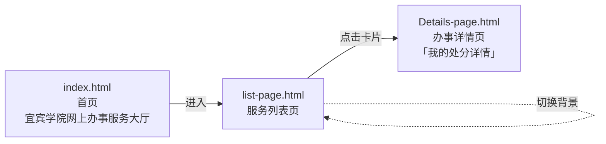
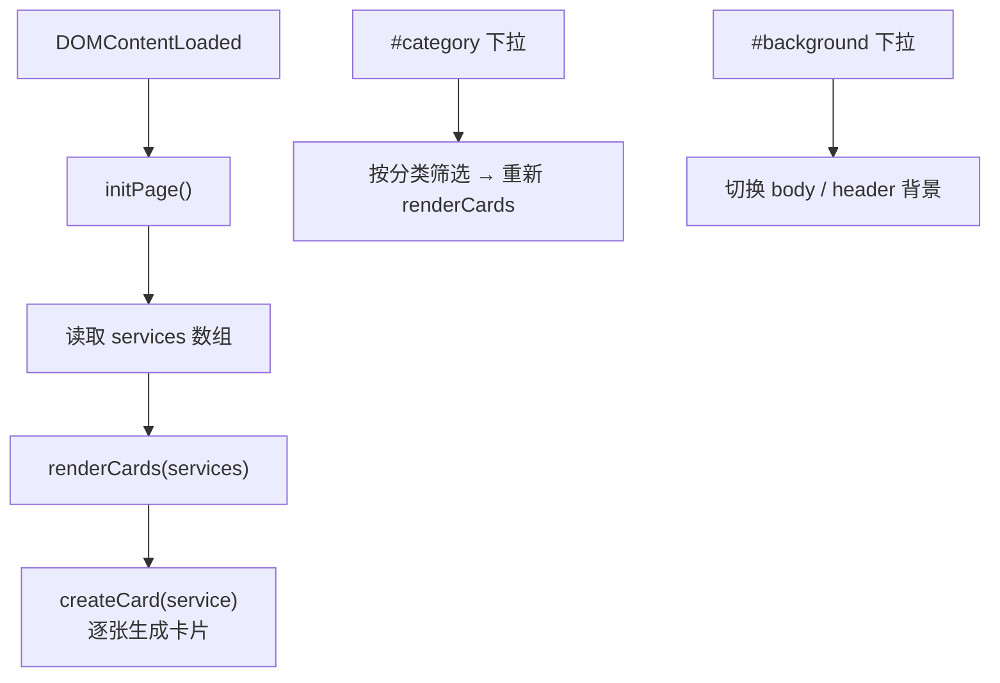

# 宜宾学院网上办事服务大厅（前端）

大二上学期 **Web 前端课程设计**作业 —— 宜宾学院「网上办事服务大厅」的前端页面实现。

纯静态页面，无后端、无构建：直接用浏览器打开 `index.html` 即可。

---

## 页面流程



| 页面 | 标题 | 内容 |
|---|---|---|
| `index.html` | 宜 宾 学 院 网 上 办 事 服 务 大 厅 | 首页入口，带文字逐字动画 |
| `list-page.html` | 宜宾学院网上办事服务大厅 | 服务卡片列表 + 分类筛选 + 背景切换 |
| `Details-page.html` | 我的处分详情 | 详情页：基本信息 / 处分详情 / 相关文件 / 评论 / 详细评论 |

---

## 功能实现

### 首页（`index.html` + `script.js`）

- **文字逐字动画**：把 `"Yibin Snake Garden"` 拆成字符数组，逐个显示
- **颜色脉冲**：`pulseAnimation()` 在 `#ffffff → #636e6e → #1c4f4c` 之间循环渐变
- 涉及元素：`#dynamicText`、`.action-button`、`.custom-image`、`footer`

### 服务列表页（`list-page.html` + `list-script.js`）



- `services` 数组为数据源，`renderCards()` 遍历生成卡片，`createCard()` 负责单卡 DOM 构建
- 两个下拉：`#category`（分类筛选）、`#background`（背景主题切换）
- 卡片容器：`#cardsContainer`

### 详情页（`Details-page.html` + `Details-page.js`）

分区块展示办事详情（基本信息 / 处分详情 / 相关文件 / 评论 / 详细评论）。

---

## 技术栈

| 项 | 说明 |
|---|---|
| 语言 | 原生 HTML + CSS + JavaScript（ES6，`"use strict"` IIFE） |
| 框架 / 库 | **无**。未引入任何第三方 JS 库或 CSS 框架 |
| 构建 | 无 |
| 开发工具 | IntelliJ IDEA（仓库含 `.idea/` 配置目录） |

---

## 目录结构

```
web-project-Online-service-hall/
├── index.html                     # 首页
├── script.js                      # 首页文字动画
├── styles.css                     # 首页样式
├── list-page.html                 # 服务列表页
├── list-script.js                 # 列表渲染 / 筛选 / 换背景
├── list-styles.css                # 列表页样式
├── Details-page.html              # 详情页
├── Details-page.js                # 详情页脚本
├── Details-page.css               # 详情页样式
├── 1B8BEFDBFF9855822C70AFDA6121AAC1.jpg      # 图片素材
├── 截屏2024-01-01 20.56.09.png               # 效果截图
└── .idea/                         # IDEA 工程配置
```

---

## 本地运行

```bash
git clone https://github.com/DLDLDL13579/web-project-Online-service-hall.git
cd web-project-Online-service-hall
open index.html
```

---

## 归属与许可证

- 本仓库**未附带 LICENSE 文件**。
- 页面为课程设计作业，文案与版式中出现的**「宜宾学院」名称及相关校方标识归宜宾学院所有**，
  本仓库仅作学习与作业存档用途，不代表校方立场。
- 未使用第三方前端库，故无第三方许可依赖。
