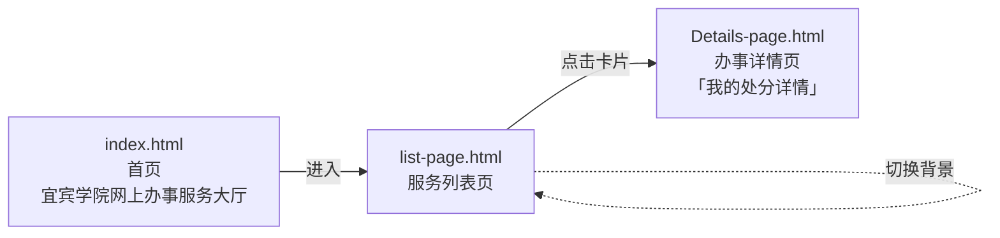
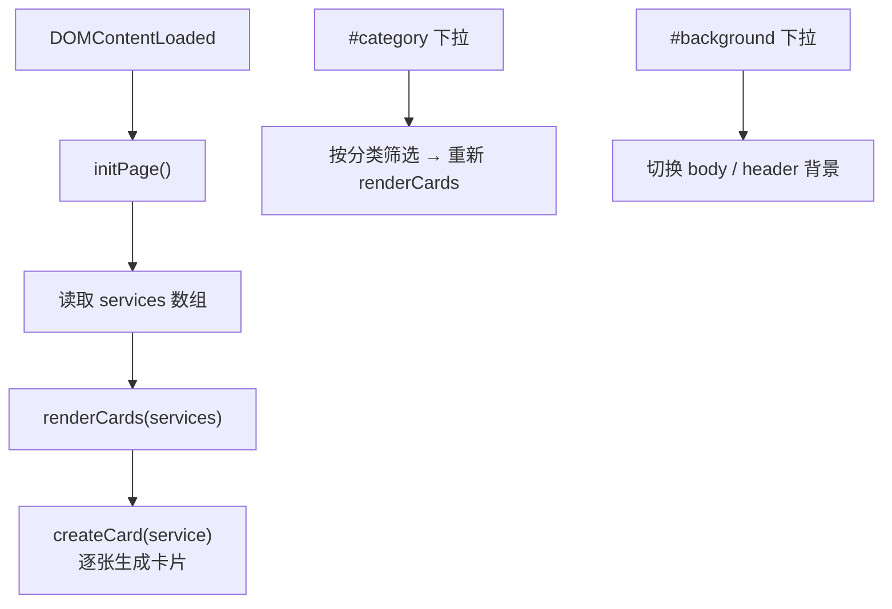

# 宜宾学院网上办事服务大厅前端 · 三页静态原型课程设计

一句话定位：大二上学期 **Web 前端课程设计**作业，用原生 HTML + CSS + JavaScript 实现的「宜宾学院网上办事服务大厅」前端页面原型。纯静态页面，**无后端、无构建、无登录、无数据持久化**，直接用浏览器打开 `index.html` 即可。

这是作者一组纯前端练习/存档仓库之一，同组仓库互相独立、无代码依赖：

| 仓库 | 内容 |
|---|---|
| [web-project-Online-service-hall](https://github.com/DLDLDL13579/web-project-Online-service-hall) | 本仓库：三页式办事大厅静态原型（首页 / 服务列表 / 办事详情） |
| [Cherry-blossom-photo-wall](https://github.com/DLDLDL13579/Cherry-blossom-photo-wall) | Canvas 樱花飘落 + 照片展示 + 背景音乐播放器 |
| [DLDLDL13579.github.io](https://github.com/DLDLDL13579/DLDLDL13579.github.io) | GitHub Pages 上的单文件点击反应小游戏 |

> 定位说明：这是课程作业存档，不是可上线的业务系统，也没有对宜宾学院真实门户的任何访问权限或后端对接。

---

## 现状 / 状态表

| 项 | 现状 |
|---|---|
| 项目性质 | 大二上学期 Web 前端课程设计作业，练手与存档用途 |
| 默认分支 | `main` |
| 主语言 | JavaScript（GitHub 元数据） |
| 仓库体积 | 587 KB |
| star / fork | 0 / 0 |
| 创建 / 最后 push | 2024-01-03 / 2026-09-17 |
| GitHub 描述 | 空 |
| 已完成 | 3 个静态页面（`index.html`、`list-page.html`、`Details-page.html`）及各自配套的 CSS / JS 文件 |
| 未完成 / 不具备 | 无后端、无数据库、无登录鉴权、无构建工具、无测试、无 CI；搜索与表单提交未见实现依据 |
| 许可证 | 根目录无 LICENSE 文件 |
| 事实包覆盖度 | 「关键文件原文」仅提供 `.idea/.gitignore`、`README.md`、`index.html` 三份；其余 6 个 js/css 与 2 个次页 HTML（共 8 个）无逐字源码 |

---

## 页面流程



| 页面 | 标题 | 内容 |
|---|---|---|
| `index.html` | 宜 宾 学 院 网 上 办 事 服 务 大 厅 | 首页入口，带文字逐字动画 |
| `list-page.html` | 宜宾学院网上办事服务大厅 | 服务卡片列表 + 分类筛选 + 背景切换 |
| `Details-page.html` | 我的处分详情 | 详情页：基本信息 / 处分详情 / 相关文件 / 评论 / 详细评论 |

上表页面标题与分区内容依据现有 `README.md` 的描述；`index.html` 的 `<title>` 与 `<h1>` 已由源码逐字确认，另两个页面的标题未获源码核对。

---

## 目录结构

按事实包「文件树」的文本清单列出，只写真实存在的文件：

```
web-project-Online-service-hall/
├── index.html                 # 首页（唯一有逐字源码的页面）
├── script.js                  # 首页文字动画 / 颜色脉冲（据 README）
├── styles.css                 # 首页样式
├── list-page.html             # 服务列表页
├── list-script.js             # 列表渲染 / 筛选 / 换背景（据 README）
├── list-styles.css            # 列表页样式
├── Details-page.html          # 详情页
├── Details-page.js            # 详情页脚本
├── Details-page.css           # 详情页样式
├── README.md                  # 现有说明文档
└── .idea/                     # IntelliJ IDEA 工程配置（元数据记录 5 个文件）
```

`.idea/.gitignore` 原文（事实包提供）：

```
# 默认忽略的文件
/shelf/
/workspace.xml
# 基于编辑器的 HTTP 客户端请求
/httpRequests/
# Datasource local storage ignored files
/dataSources/
/dataSources.local.xml
```

**关于文件清单的口径**：元数据记录一级分布为「根文件 12 个 + `.idea` 5 个」，共 17 个文件；上方文本清单列出 10 个根文件。现有 `README.md` 的目录结构还写了 `1B8BEFDBFF9855822C70AFDA6121AAC1.jpg` 与 `截屏2024-01-01 20.56.09.png` 两个图片资源，但事实包文件树的文本清单未列出它们，且 `index.html` 并未引用这两个本地文件（见「已知问题」）。因此本文不把这两个图片当作已确认存在的文件写入目录树。

---

## 关键实现

### 首页：`index.html` 逐字片段

事实包提供了 `index.html` 的完整源码，以下是 `<body>` 主体（逐字摘录）：

```html
  <!-- 页面中间显示 -->
  <section class="main-content" style="background-image: url('https://zos.alipayobjects.com/rmsportal/gGlUMYGEIvjDOOw.jpg');">
    <h1>宜 宾 学 院 网 上 办 事 服 务 大 厅</h1>
    <div class="dynamic-text" id="dynamicText">Y    i    b    i    n            S    n    a    k    e            G    a    r    d    e    n</div>
    <div class="search-box">
      <input type="text" placeholder="点击搜索...">
      <button>搜索</button>
    </div>
   <!-- 直接插入图片 -->
    
    <a href="list-page.html" class="action-button">   启    动   </a>
  </section>

  <!-- 页脚 -->
  <footer>
    <p>© 2023 宜宾学院. 保留所有权利.</p>
  </footer>

  <!-- 引入 JavaScript 文件 -->
  <script src="script.js"></script>
```

**为什么这么设计（可从源码直接读出的信息）**：

1. **三页靠硬编码相对路径串联，不用路由**：全站唯一的页面跳转是 `<a href="list-page.html" class="action-button">启 动</a>`。对课程作业来说，纯静态文件 + 相对链接是最省事的形态，不需要任何框架或服务器路由；代价是没有状态管理，页面间无法传递数据。
2. **背景与校徽都用外链，不落本地文件**：`section.main-content` 的背景是支付宝图床 `zos.alipayobjects.com` 的一张图，`img.custom-image` 直接引用宜宾学院门户 `ehall.yibinu.edu.cn` 的 logo。这解释了为什么仓库目录树里没有图片素材文件——作业原型直接借用了线上资源，但也让页面在离线或外链失效时丢图。
3. **`#dynamicText` 的初始内容是一串带大量空格的字母**：它是逐字动画的占位文本，由 `script.js`（该脚本无逐字源码）配合 `styles.css` 呈现；现有 `README.md` 描述动画是把 `"Yibin Snake Garden"` 拆成字符数组逐个显示。
4. **搜索框只有 UI**：`<input>` + `<button>` 既没有 `<form>`/`action`，事实包也没有 `script.js` 绑定它的证据，`README.md` 的功能清单同样未列搜索功能。应视为静态占位，不是已实现功能。
5. **只引入一个脚本**：`<script src="script.js"></script>`，页面无内联 JS、无模块加载器，符合「原生 ES6、无第三方库」的技术选型。

### 功能实现（依据现有 `README.md` 的描述）

> 提醒：以下要点来自现有 `README.md`，事实包**未提供** `script.js` / `list-script.js` / `Details-page.js` / 各 CSS / 两个次页 HTML 的逐字源码，因此属于文档级描述，未逐字核对代码。

**首页（`index.html` + `script.js`）**

- **文字逐字动画**：把 `"Yibin Snake Garden"` 拆成字符数组，逐个显示
- **颜色脉冲**：`pulseAnimation()` 在 `#ffffff → #636e6e → #1c4f4c` 之间循环渐变
- 涉及元素：`#dynamicText`、`.action-button`、`.custom-image`、`footer`

**服务列表页（`list-page.html` + `list-script.js`）**



- `services` 数组为数据源，`renderCards()` 遍历生成卡片，`createCard()` 负责单卡 DOM 构建。数据写死在前端脚本里，是纯静态原型的典型做法——不需要接口即可演示筛选交互。
- 两个下拉：`#category`（分类筛选）、`#background`（背景主题切换）
- 卡片容器：`#cardsContainer`

**详情页（`Details-page.html` + `Details-page.js`）**

分区块展示办事详情（基本信息 / 处分详情 / 相关文件 / 评论 / 详细评论）。事实包未提供该页源码，也未提供任何数据来源，推断为静态填充内容，请勿当作真实业务数据。

---

## 参数与常量表

「出处」一列区分**代码级证据**（`index.html` 逐字源码）与**文档级证据**（现有 `README.md` 描述）。

| 常量 / 标识 | 值 | 出处 |
|---|---|---|
| 页面编码 | `UTF-8`（`<meta charset="UTF-8">`） | `index.html`（代码） |
| 页面语言 | `zh-CN` | `index.html`（代码） |
| viewport | `width=device-width, initial-scale=1.0` | `index.html`（代码） |
| 首页标题 | `宜 宾 学 院 网 上 办 事 服 务 大 厅` | `index.html` `<title>` / `<h1>`（代码） |
| 动态文案 | `Yibin Snake Garden`；HTML 内为带空格的逐字占位 | `index.html` `#dynamicText`（代码）+ `README.md` |
| 首页背景图 | `https://zos.alipayobjects.com/rmsportal/gGlUMYGEIvjDOOw.jpg` | `index.html`（代码） |
| 校徽图片 | `https://ehall.yibinu.edu.cn/new/portal/custom/img/logo/logo-mini.png` | `index.html`（代码） |
| 校徽 alt | `宜宾学院log` | `index.html`（代码） |
| 搜索框占位符 | `点击搜索...` | `index.html`（代码） |
| 入口链接 | `list-page.html` | `index.html`（代码） |
| 页脚文案 | `© 2023 宜宾学院. 保留所有权利.` | `index.html`（代码） |
| 首页样式 / 脚本 | `styles.css` / `script.js` | `index.html`（代码） |
| 颜色脉冲取值 | `#ffffff` → `#636e6e` → `#1c4f4c`，函数 `pulseAnimation()` | `README.md`（文档，未核对 `script.js`） |
| 列表页容器 | `#cardsContainer` | `README.md`（文档） |
| 列表页下拉 | `#category`、`#background` | `README.md`（文档） |
| 列表页数据与函数 | `services`、`renderCards()`、`createCard()`、`initPage()` | `README.md`（文档） |
| 详情页分区 | 基本信息 / 处分详情 / 相关文件 / 评论 / 详细评论 | `README.md`（文档） |
| 文件数 | 共 17 个（根文件 12 + `.idea` 5） | 事实包元数据 |

事实包未提供任何可在运行时调节的参数（无 yaml、无 `declare_parameter`、无配置文件），因此本表不含默认参数值；交互行为写死在 JS 中，详见源码。

---

## 技术栈

| 项 | 说明 |
|---|---|
| 语言 | 原生 HTML + CSS + JavaScript（现有 README 记为 ES6、`"use strict"` IIFE） |
| 框架 / 库 | **无**。未引入任何第三方 JS 库或 CSS 框架（据现有 README；`index.html` 只引 `script.js` 与 `styles.css`，可佐证） |
| 构建 | 无 |
| 后端 | 无 |
| 开发工具 | IntelliJ IDEA（仓库含 `.idea/` 配置目录） |
| 运行期外部资源 | 2 张外链图片（`zos.alipayobjects.com`、`ehall.yibinu.edu.cn`） |

---

## 快速开始

**前置条件**：任意现代浏览器即可，不需要 Node.js、Python、数据库或构建工具；macOS 可用 `open`，其他系统直接双击 `index.html`。若希望首页背景与校徽正常显示，需要能访问 `zos.alipayobjects.com` 与 `ehall.yibinu.edu.cn` 两个外链域名；离线状态下页面仍可打开，只是图片缺失。

```bash
git clone https://github.com/DLDLDL13579/web-project-Online-service-hall.git
cd web-project-Online-service-hall
open index.html
```

进入首页后点击「启 动」跳转到 `list-page.html`；列表页的卡片、分类筛选与背景切换、详情页内容均依赖仓库内的 JS/CSS 文件，请保持目录结构完整，不要单独复制 HTML 文件。

---

## 已知问题

| # | 问题 | 证据 | 影响 / 建议 |
|---|---|---|---|
| 1 | **文档描述落后于文件树**：现有 `README.md` 目录结构列了 `1B8BEFDBFF9855822C70AFDA6121AAC1.jpg` 与 `截屏2024-01-01 20.56.09.png`，但事实包文件树的文本清单没有这两个文件；`index.html` 引用的是两张外链图片，也不引用这两个本地文件 | 事实包文件树 + `index.html` 源码 + `README.md` 原文 | 部署或复现前先 `ls` 核对实际文件；以文件树与源码为准，不要按旧 README 找图片 |
| 2 | 页面依赖两张外部图片（支付宝图床、校方 `ehall.yibinu.edu.cn`），离线 / 外链失效 / 校方站点改版时背景与校徽不显示 | `index.html` 源码 | 若需长期存档，把图片本地化并改用相对路径；注意校徽权利归校方 |
| 3 | 「无第三方库」的说法只对 JS/CSS 成立，页面仍有运行期外部资源依赖 | `index.html` 源码 + `README.md` | 技术栈表述已在本文补上「运行期外部资源」一行 |
| 4 | 搜索框只有 `input` + `button`，无 `form`/`action`，事实包无 `script.js` 绑定证据，README 功能清单也未列搜索 | `index.html` 源码 + `README.md` | 判定为静态占位，不可当作已实现功能；若要实做需补前端逻辑与数据源 |
| 5 | **证据覆盖不足**：事实包「关键文件原文」只有 `.idea/.gitignore`、`README.md`、`index.html`；其余 8 个页面/脚本/样式文件（`list-page.html`、`Details-page.html`、`script.js`、`list-script.js`、`Details-page.js`、`styles.css`、`list-styles.css`、`Details-page.css`）均无逐字源码。`services`、`renderCards()`、`createCard()`、`pulseAnimation()`、`#category`/`#background`/`#cardsContainer`、颜色脉冲三个取值、「卡片点击进入详情页」等结论全部只来自现有 README 描述 | 事实包「关键文件原文」清单 | 存在「文档描述落后于代码」风险，需对照仓库源码逐项复核后再引用具体值 |
| 6 | 首页动态文案 `Yibin Snake Garden` 与页面主题（网上办事服务大厅 / 我的处分详情）语义无关，属练手占位文案 | `index.html` `#dynamicText` | 存档说明中不要把它当作正式栏目名 |
| 7 | 页脚写有 `© 2023 宜宾学院. 保留所有权利.`，是学生作业页面内的校方版权文案，而仓库根目录无 LICENSE | `index.html` + 事实包元数据 | 该文案不构成对仓库代码的授权；复用前需与作者确认，见「归属与许可证」 |
| 8 | 校徽 `alt="宜宾学院log"` 疑似拼写笔误（`log` 应为 `logo`） | `index.html` 源码 | 无障碍文本不准确，可顺手修正 |
| 9 | `.idea/`（5 个文件）被提交进仓库；其 `.gitignore` 只忽略 `shelf/`、`workspace.xml`、`httpRequests/`、`dataSources/` 等，其余 IDE 配置仍入库 | 事实包元数据 + `.idea/.gitignore` 原文 | IDE 工程配置入库属常见冗余，建议整目录加入 `.gitignore` |
| 10 | 三页之间无路由、无状态管理、无数据来源；详情页「处分详情」等分区在事实包中无任何数据依据 | `index.html` 源码 + 事实包范围 | 属静态原型，切勿填入或当作真实个人信息展示 |
| 11 | 仓库 GitHub 描述为空、star/fork 均为 0、无 CI / 测试 / LICENSE，最后 push 为 2026-09-17 | 事实包元数据 | 明确为课程作业存档，不应视为已稳定验证的可维护系统 |

本仓库事实包中未出现 `.env`、`application.yml`、明文凭据、绑定 `0.0.0.0` 或 CORS 全开的配置，故无凭据轮换类告警。

---

## 归属与许可证

- **根目录无 LICENSE 文件**（事实包元数据）。未补充 LICENSE 之前，仓库代码默认「保留所有权利」，复用需先取得作者授权。
- 页面为课程设计作业。页面原型、文案中的**「宜宾学院」名称、校方标识以及 `ehall.yibinu.edu.cn` 上的 logo 归宜宾学院所有**，本仓库仅作学习与作业存档用途，不代表校方立场。校名/校徽与门户视觉原型**非作者原创**，权利归各自权利人。
- `index.html` 页脚的 `© 2023 宜宾学院. 保留所有权利.` 是作业页面内的文案，不构成对本仓库代码的授权声明，也不改变上一条的归属判断。
- 据现有 README，未引入第三方 JS/CSS 库，故无第三方库许可依赖；但页面外链了两张第三方/校方图片，其权利归各自权利人。
- 仓库不是第三方整站副本，事实包中也未出现其他上游组件；若后续补入图片素材或库文件，应同步补齐来源与许可说明。
